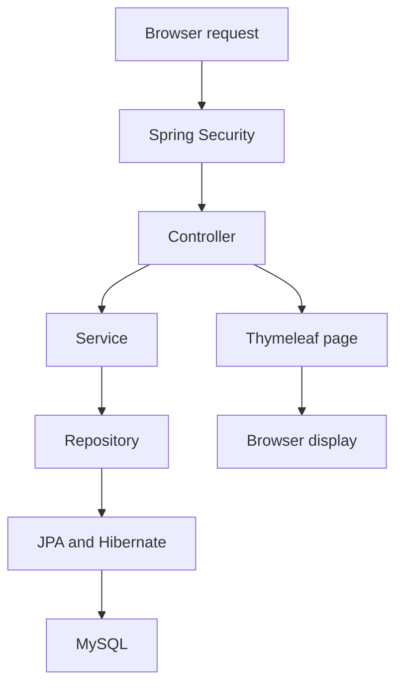

# CATS – Course Application Tracking System

Course Application Tracking System (CATS) developed for the NUS-ISS Graduate Diploma in Systems Analysis (GDipSA), SA4105 Web Application Development Continuous Assessment.

The system manages employee training/course applications, manager approval workflows, training-day allowances, annual training budgets, course scheduling rules, and related administration.

---

## 1. Technology Stack

### Backend

| Technology                             | Purpose                                                                                                       |
| -------------------------------------- | ------------------------------------------------------------------------------------------------------------- |
| Java 21                                | The language used for the application code.                                                                   |
| Spring Boot 4.1.1                      | Starts the application and connects its parts.                                                                |
| Spring MVC                             | Handles requests from the browser.                                                                            |
| Spring Data JPA                        | Provides repository methods to find and save records.                                                         |
| Hibernate                              | Maps Java objects to database tables and runs the database queries.                                           |
| Spring Security                        | Handles login, password checking and access rules.                                                            |
| Spring Validation / Jakarta Validation | Provides validation support. The current application also checks inputs directly in controllers and services. |
| Spring Mail                            | Sends application submission and decision emails.                                                             |
| Lombok                                 | Generates repeated Java code, such as getters and constructors.                                               |
| Maven                                  | Downloads libraries and builds the application.                                                               |

The libraries are listed in `cats/pom.xml`. The Maven wrapper is included, so Maven does not need to be installed separately.

The Java library files are included in `cats/lib/`. Maven may still need internet access to download build tools when building or running the source code.

### Database

- **MySQL Server** stores accounts, employee profiles, courses, applications, allowances, holidays and claims.
- **MySQL Connector/J** connects the Java application to MySQL.
- **MySQL Workbench** is a tool for viewing records and running SQL commands. It is separate from MySQL Server.

The local database name used in this guide is `cats`.

### Frontend

- Thymeleaf builds the HTML pages using data supplied by the controllers.
- HTML and CSS provide the page content and appearance.
- JavaScript helps update form fields, such as the course end date.
- Chart.js displays the training ledger chart. A local copy and its licence are included in `cats/src/main/resources/static/js/`.

### Development Tools

- Spring Tool Suite / Spring Tools for Eclipse: write and run the Java project.
- Git: track code changes.
- GitHub: store the shared repository and review changes through pull requests.
- Jira: track team tasks and issues.
- MySQL Workbench: work with the database.
- Browser developer tools: inspect requests, forms and security responses.

GitHub and Jira are team development tools. They are not required to run a downloaded copy of CATS locally.

---

## 2. Application Architecture

The application follows a layered architecture. Each part has a different responsibility.



1. Spring Security checks login and access rules before the request reaches a controller.
2. The controller reads the submitted values and logged-in user, performs input and request checks, and calls the service.
3. The service applies business rules, such as date, allowance and ownership checks.
4. The repository finds or saves records through JPA and Hibernate.
5. The controller supplies page data to Thymeleaf, which returns HTML to the browser.

Controllers also contain some checks and database lookups. Business rules are mainly in services, but not every check is in a service.

For a course submission, the main flow is:

`ApplicationController` → `ApplicationService` → `ApplicationRepository` → MySQL.

The current application mainly returns web pages. Its two DTO classes hold report and calendar data; they are not a general request/response API layer.

---

## 3. Project Package Structure

The Java code is under `cats/src/main/java/sg/edu/nus/cats/`.

### Package Responsibilities

| Package      | Responsibility                                                      | Examples                                                              |
| ------------ | ------------------------------------------------------------------- | --------------------------------------------------------------------- |
| `config`     | Supporting startup code. `InitialData` is currently disabled.       | `InitialData`                                                         |
| `controller` | Handles browser requests and selects pages.                         | `ApplicationController`, `ManagerController`, `EmployeeController`    |
| `dto`        | Holds data prepared for reports and the training calendar.          | `TrainingBudgetReportDto`, `TrainingCalendarEntryDto`                 |
| `model`      | Contains database models and the fixed lists of roles and statuses. | `User`, `Employee`, `CourseApplication`, `Role`                       |
| `repository` | Finds and saves database records.                                   | `UserRepository`, `ApplicationRepository`, `ClaimRepository`          |
| `security`   | Handles authentication, access rules and actions after login.       | `SecurityConfig`, `CatsUserDetailsService`, `CatsLoginSuccessHandler` |
| `service`    | Applies business rules and coordinates database work.               | `ApplicationService`, `AllowanceService`, `ClaimService`              |
| `utils`      | Provides shared checks for the logged-in account and employee.      | `AdminAuthHelper`, `EmployeeAuthHelper`                               |

### Other Project Files

| Location                                          | Contents                                    |
| ------------------------------------------------- | ------------------------------------------- |
| `cats/pom.xml`                                    | Libraries and build settings.               |
| `cats/mvnw`, `cats/mvnw.cmd`, `cats/.mvn/`        | Maven wrapper files.                        |
| `cats/src/main/resources/templates/`              | Thymeleaf HTML pages.                       |
| `cats/src/main/resources/templates/fragments/`    | Shared header, footer and calendar content. |
| `cats/src/main/resources/static/`                 | Shared CSS.                                 |
| `cats/src/main/resources/data.sql`                | Current seeded demonstration records.       |
| `cats/src/main/resources/application*.properties` | Application settings.                       |
| `cats/src/test/`                                  | Test classes and test settings.             |
| `database/cats-demo.sql`                          | Older database export from 2 October.       |

Code reference: [Java packages](https://github.com/devil87decg/cats-assignment/tree/f4fd373f9c16d882935c6466a9dc726cff413d81/cats/src/main/java/sg/edu/nus/cats).

---

## 4. Domain Model

The domain model describes the records used by CATS. The classes are in `model/`.

### User

`User` stores the login account:

- user ID
- username
- password hash
- one role: `ADMIN`, `MANAGER` or `EMPLOYEE`
- active status

A manager can use employee application functions through their employee profile. This does not require a second role on the same account.

### Employee

`Employee` stores the staff profile:

- employee ID and linked `User`
- name and email
- designation and department
- staff category: `ADMINISTRATIVE` or `PROFESSIONAL`
- supervisor, linked to another `Employee`

This avoids requiring a separate Manager model. One supervisor can have many employees. Annual allowances are stored separately in `TrainingAllowance`.

### Training Provider

`TrainingProvider` stores a provider's ID, name, description and active status. Each course references its provider.

### Course Catalogue

`Course` represents a predefined course. Information includes:

- course ID, code, title and description
- category and training provider
- location
- fee and duration in days
- active status

A new application must select a course from the catalogue.

### Course Category

`CourseCategoryMaster` stores the category code, name, description and active status. Its `internalTraining` setting determines whether internal-training rules apply.

The seed data includes `INTERNAL`, `EXTERNAL` and `CERTIFICATION`. Administrators can maintain category records.

### Course Application

`CourseApplication` stores:

- application ID, employee and selected course
- course title and training provider name
- start and end dates
- duration and course fee
- justification and work dissemination
- application status
- manager reason, decision maker and decision date/time
- course experience comment

It also reads an older category column for existing records. New application category checks use the selected course's category.

### Training Allowance

`TrainingAllowance` stores an employee's year, day limit and fee budget. There can be only one allowance record for the same employee and year.

### Public Holiday

`PublicHoliday` stores a holiday date and name. A holiday date cannot be duplicated.

### Course Fee Claim

`CourseFeeClaim` stores the linked application, amount, claim date/time, receipt and certificate file paths, status and manager decision details. Each application can have at most one claim.

### Main Relationships

| Relationship                    | Meaning                                                                  |
| ------------------------------- | ------------------------------------------------------------------------ |
| Employee → User                 | Each employee profile has one login account.                             |
| Employee → Supervisor           | Several employees can report to the same employee with the manager role. |
| Course → Category / Provider    | Each course has a category and provider.                                 |
| Application → Employee / Course | Each application belongs to an employee and selected course.             |
| Allowance → Employee            | An employee can have allowances for different years.                     |
| Claim → Application             | An application can have one claim.                                       |

---

## 5. Course Application Status

| Status      | Meaning                                                 |
| ----------- | ------------------------------------------------------- |
| `APPLIED`   | Newly submitted application.                            |
| `UPDATED`   | Pending application edited by the employee.             |
| `APPROVED`  | Approved by the manager.                                |
| `REJECTED`  | Rejected by the manager.                                |
| `CANCELLED` | Approved application cancelled by the employee.         |
| `COMPLETED` | Employee recorded completion and an experience comment. |
| `DELETED`   | Pending application marked as deleted.                  |

Typical successful lifecycle:

**Employee submits → APPLIED → Manager approves → APPROVED → Course ends → Employee records experience → COMPLETED.**

Pending applications can also be updated, rejected or deleted. Approved applications can be cancelled.

Code reference: `model/ApplicationStatus.java` and `service/ApplicationService.java`.

---

## 6. Course Application Submission

Employees submit applications through the web form at `/applications/new`.

The form submits to `POST /applications`. The logged-in employee is identified from the session created after login.

Submission processing includes:

1. Find the logged-in employee.
2. Find the selected active course.
3. Copy its title, provider and fee into the application.
4. Check required values and course dates.
5. Count training days and compare them with the course duration.
6. Check overlapping applications, annual day limit and fee budget.
7. Set the status to `APPLIED` and save the application.
8. Send a submission notice to the manager when email is configured.

Code reference: `ApplicationController.submitApplication()` and `ApplicationService.submit()`.

---

## 7. Training-Day Calculation

Training duration is calculated by `TrainingDayService`.

The calculation considers the start date, end date, weekends and dates recorded in the public-holiday table.

### Working Days

Saturday and Sunday are excluded. For example, a course from Friday to Monday counts as **2 training days**, provided neither working date is a recorded holiday.

### Public Holidays

`HolidayRepository.existsByDate()` checks whether a date is in the database. CATS excludes only holidays recorded there. Administrators maintain them through the holiday pages.

`TrainingDayService.calculateEndDate()` also calculates an end date from the chosen start date and course duration.

---

## 8. Single-Day Courses

A course may have the same start and end date.

A normal single-day course counts as **1 training day**, provided the date is a working day and the selected course has a one-day duration.

---

## 9. Half-Day Training

Half-day training is supported for internal training.

A valid half-day course has:

- an internal-training category
- catalogue duration of `0.5` day
- the same working date for its start and end

The saved duration is **0.5 day**. Half-day external courses, certifications and multi-day half-day applications are rejected.

Code reference: `ApplicationService.validate()`.

---

## 10. Course Date Validation

Current rules include:

- start date must be after today
- end date cannot be before the start date
- start and end dates must be in the same year
- both dates must be working days
- counted working days must match the selected course duration

The form displays a validation message when these checks fail.

---

## 11. Annual Training-Day Allowance

Each employee has a saved annual allowance.

**Annual day limit − qualifying application days = remaining training days.**

The new application is rejected if the total would exceed the saved day limit.

`APPLIED`, `UPDATED`, `APPROVED` and `COMPLETED` applications count towards usage. `REJECTED`, `DELETED` and `CANCELLED` applications do not count.

New employee profiles receive a default of **5 days for administrative staff** or **10 days for professional staff**. Administrators can change the saved allowance.

Code reference: `ApplicationService` and `AllowanceService`.

---

## 12. Annual Training Budget

Employees also have an annual fee budget.

**Annual fee budget − qualifying course fees = remaining budget.**

Internal training has a fee of zero and does not use the fee budget. Paid external courses and certifications are checked against the saved budget.

New employee profiles receive a default **S$2,000** fee budget. Administrators can change it. Seeded records contain different budgets for demonstration.

Code reference: `ApplicationService.validate()` and `AllowanceService.createDefaultAllowance()`.

---

## 13. Overlapping Course Validation

Employees cannot submit conflicting applications while the existing applications are `APPLIED`, `UPDATED` or `APPROVED`.

Example: an existing course from 2–4 November overlaps a new course from 3–5 November. CATS rejects the new request with a validation message.

During an update, the current application is excluded so it does not conflict with itself or use its allowance twice.

Code reference: `ApplicationService.validate()`.

---

## 14. Employee Application Operations

The employee workflow supports:

- submit an application
- list own applications for the current year, with page navigation
- view application details
- update a pending application
- delete a pending application
- cancel an approved application
- complete an approved course

### Update Application

Only `APPLIED` or `UPDATED` applications may be edited. The service repeats the date, duration, overlap and allowance checks. A successful update keeps the same application ID and sets the status to `UPDATED`.

### Delete Application

The record is not physically removed. Its status becomes `DELETED`, preserving its history. The current listing retrieves records for the employee and year, including deleted records.

### Cancel Approved Application

Only an `APPROVED` application can be cancelled. Its status becomes `CANCELLED`.

Code reference: `ApplicationController` and `ApplicationService`.

---

## 15. Manager Approval Workflow

A manager can:

- view pending applications from assigned subordinates
- view application details and overlapping approved courses from other subordinates
- approve or reject a pending application
- view subordinate profiles and course history

The system checks both the manager role and the applicant's assigned supervisor.

### Manager Approval / Rejection

A pending application becomes `APPROVED` or `REJECTED`. CATS records the manager's reason, decision maker and decision date/time.

A reason is required for both decisions. An empty reason produces a validation message.

Code reference: `ManagerController`, `ApplicationService.decide()` and `EmployeeService`.

---

## 16. Workflow Protection

The service prevents actions that are not allowed for the application's current status.

| Action                    | Allowed status                 |
| ------------------------- | ------------------------------ |
| Edit or delete            | `APPLIED`, `UPDATED`           |
| Manager approve or reject | `APPLIED`, `UPDATED`           |
| Cancel                    | `APPROVED`                     |
| Complete                  | `APPROVED`, after the end date |

An employee cannot act on another employee's application. A manager cannot decide another manager's subordinate's application or repeatedly decide an application that has already been decided.

---

## 17. Course Completion

An employee may mark their approved course as completed **after its end date**.

The employee enters an experience comment in the application details page. The form submits to `POST /applications/{id}/complete`.

The experience comment is required. Completion on or before the end date is rejected. A successful completion sets the status to `COMPLETED`.

Code reference: `ApplicationService.complete()`.

---

## 18. DTOs and Page Data

The current DTO classes are:

| Class                      | Purpose                                                                    |
| -------------------------- | -------------------------------------------------------------------------- |
| `TrainingBudgetReportDto`  | Holds one employee's allowance, usage and remaining amounts for a report.  |
| `TrainingCalendarEntryDto` | Groups a course and its dates with the approved applications attending it. |

Controllers add data to Spring's `Model`. Thymeleaf reads that data to display the page. The project does not have the request/response mapper classes described in the older README.

---

## 19. Request Validation

Controllers and services check submitted values before saving records.

Examples include:

- required course, dates and justification
- active course selection
- future working dates and matching duration
- annual allowance and budget
- employee ownership and manager assignment
- required decision reason and completion comment

Course values such as the fee are read from the saved catalogue record. For a calendar-based application, the controller also uses the calendar course and date stored in the session.

HTML fields provide basic browser checks. Server checks are still required because browser values can be changed.

---

## 20. Validation Messages and Error Handling

Services report invalid requests using exceptions such as `IllegalArgumentException`.

Controllers catch many of these errors and display the message on the form or after redirecting to another page.

Example: **“Course period overlaps another application”.**

`TrainingCalendarAdvice` supplies calendar data to pages. It is not a global API error handler. The current code does not contain the `GlobalExceptionHandler` or JSON error format described in the older README.

---

## 21. Employee Administration

Administrators can:

- create a login account and linked employee profile
- assign a role, staff category and supervisor
- edit employee details
- reset an account password
- set the current year's training-day allowance and fee budget
- remove an employee with no application history, or deactivate an account whose application history must be kept

A manager's subordinates must be reassigned before that manager can be removed. The administrator cannot delete their own account through the employee page.

Course, category, provider and holiday administration pages are also implemented.

Code reference: `EmployeeController`, `EmployeeService`, `AccountService`, `AllowanceController` and the course/category/provider/holiday controllers.

---

## 22. Development Data

`cats/src/main/resources/data.sql` contains the current sample accounts, profiles, reporting relationships, courses, applications, allowances and holidays.

For the added seeded accounts, **username and password are the same**.

| Role          | Recommended username | Password   |
| ------------- | -------------------- | ---------- |
| Administrator | `syahmul`            | `syahmul`  |
| Employee      | `syahmul2`           | `syahmul2` |
| Manager       | `syahmul3`           | `syahmul3` |

`syahmul2` reports to `syahmul3`. The seed data also includes equivalent account sets for Hafizah, Chloe, Aufa, Xiuming, Xinxian, Ramesh and Dominic. The added managers report to `ceo`, whose password is `ceo`.

The original demo accounts on the login page can also be used. Their records were used to test the initial CATS code and were not cleaned or standardised. Use the added seeded accounts for the main demonstration.

Most sample records are for **2026**. Reports and the training ledger support year selection; the employee application list shows the current year.

`config/InitialData.java` exists, but its `@Component` annotation is commented out. It does not currently run at startup.

---

## 23. Database Configuration

The shared `application.properties` selects the `local` setup. Create your own `application-local.properties` in `cats/src/main/resources/`.

A complete example is provided in section 29. Do not share real database or mail passwords in GitHub.

### Hibernate Local Mode

Use:

```properties
spring.jpa.hibernate.ddl-auto=update
```

This lets Hibernate create or update the application tables while keeping records when CATS stops.

The project's `test` setup uses `create-drop`, which deletes and recreates tables. Do not use that setup for records you want to keep.

The `aws` settings are for a separate hosted setup and are not needed to run locally.

---

## 24. Current Security Status

Spring Security is integrated in the current application.

- `SecurityConfig` defines login and access rules.
- `CatsUserDetailsService` finds the account through `UserRepository` and supplies its password hash, role and active status.
- Spring Security checks the password using BCrypt and blocks inactive accounts.
- `CatsLoginSuccessHandler` records the logged-in user's details in the session and sends them to the appropriate home page.
- `/admin` pages require the administrator role; `/manager` pages require the manager role.
- Application pages allow employees and managers.
- Ownership and supervisor checks further restrict application and claim actions.
- Logout submits a POST request and clears the session.
- CSRF protection checks the security token on submitted forms.

Users are identified through login and session information. The application does not use a username supplied in a query parameter as its login method.

---

## 25. Checks to Try in the Browser

Use the seeded accounts to try:

1. Log in as `syahmul2` and submit a valid course application.
2. Try overlapping dates or dates that do not match the course duration.
3. Edit or delete a pending application.
4. Log in as `syahmul3` and review the employee's pending request.
5. Try approving or rejecting without a reason, then enter a reason and submit.
6. Return to the employee account and view the decision.
7. Try completing an approved course on or before its end date.
8. As an employee, try opening `/admin/employees` or `/manager/applications`; access should be denied.
9. View the training calendar, manager reports and CSV downloads.
10. Try a claim for a completed paid course with a receipt and certificate.

These are suggested checks. This README review did not run them or confirm that the automated tests pass.

---

## 26. Current Implementation Status

The MVP list below covers the core employee and manager application workflow. The optional list covers the additional features described in this README. These headings organise the implemented features; they are not a separate audit of the assignment marking requirements.

### MVP Features

| Feature                                     | Code reference                                     |
| ------------------------------------------- | -------------------------------------------------- |
| Login, logout and role access               | `security/`, `LoginController`, `login.html`       |
| Employee application submission and details | `ApplicationController`, `ApplicationService`      |
| Pending application editing and deletion    | `ApplicationService.update()` / `delete()`         |
| Approved application cancellation           | `ApplicationService.cancel()`                      |
| Course completion and experience comment    | `ApplicationService.complete()`                    |
| Working-day and public-holiday calculation  | `TrainingDayService`, `HolidayRepository`          |
| Half-day and course-duration checks         | `ApplicationService.validate()`                    |
| Annual training-day and fee-budget checks   | `ApplicationService`, `AllowanceService`           |
| Overlapping application checks              | `ApplicationService.validate()`                    |
| Manager approval/rejection with a reason    | `ManagerController`, `ApplicationService.decide()` |
| Subordinate profiles and course history     | `ManagerController`, `EmployeeService`             |
| Employee ownership and supervisor checks    | `ApplicationService`, `EmployeeService`            |

### Optional / Additional Features

| Feature                                                       | Code reference                                                                   |
| ------------------------------------------------------------- | -------------------------------------------------------------------------------- |
| Employee account/profile administration and password reset    | `EmployeeController`, `EmployeeService`, `AccountService`                        |
| Allowance administration                                      | `AllowanceController`, `AllowanceService`                                        |
| Course, category and provider administration                  | Corresponding controllers, services and repositories                             |
| Public-holiday administration                                 | `HolidayController`, `HolidayService`                                            |
| Change own password                                           | `AccountController`, `AccountService`                                            |
| Submission and decision emails                                | `EmailService`                                                                   |
| Training calendar and calendar-based application              | `TrainingCalendarService`, `TrainingCalendarController`, `ApplicationController` |
| Attendance and budget reports with CSV export                 | `ReportController`, `ReportService`                                              |
| Page navigation for application/history lists                 | `ApplicationController`, `ManagerController`, `ApplicationRepository`            |
| Course fee claims with document uploads and manager decisions | `ClaimController`, `ClaimService`, `ManagerController`                           |
| Training ledger and reimbursement status                      | `ClaimController`, `ClaimService`, `training-ledger.html`                        |

Claim statuses are `PENDING`, `APPROVED`, `REJECTED` and `REIMBURSED`. Only completed, paid courses outside internal training are eligible. Each claim requires a receipt and completion certificate. The employee can mark their approved claim as reimbursed; CATS records the status, but does not transfer money.

---

## 27. Recommended Code Reading Order

| Order | Read                                                           | What to look for                                                        |
| ----- | -------------------------------------------------------------- | ----------------------------------------------------------------------- |
| 1     | `model/`                                                       | Accounts, staff profiles, courses, applications, allowances and claims. |
| 2     | `repository/`                                                  | Methods that find and save records.                                     |
| 3     | `security/`                                                    | Login, access rules and session details.                                |
| 4     | `TrainingDayService`, `AllowanceService`, `ApplicationService` | Date calculations and application rules.                                |
| 5     | `ApplicationController`, `ManagerController`                   | How employee and manager requests call services.                        |
| 6     | `templates/`, `static/css/cats.css`                            | How pages display data and submit forms.                                |
| 7     | Administration, report, calendar and claim classes             | Additional features.                                                    |
| 8     | `data.sql` and `src/test/`                                     | Sample records and included tests.                                      |

Java references above are relative to `cats/src/main/java/sg/edu/nus/cats/`. Page templates and settings are in `cats/src/main/resources/`.

---

## 28. Git Workflow

Clone the repository:

```bash
git clone --branch main https://github.com/devil87decg/cats-assignment.git
```

Before starting work:

```bash
git pull
```

Check changes:

```bash
git status
```

Commit and push changes:

```bash
git add .
git commit -m "Describe the change"
git push
```

For team development, use a feature branch and a GitHub pull request rather than having every developer modify `main` directly. Track the related work in Jira.

---

## 29. Running the Application

### Install and Prepare

1. Install Java JDK 21 and MySQL Server.
2. Start MySQL Server.
3. Download and unzip the project, or clone `main`.
4. Open MySQL Workbench or a MySQL client and create a fresh database:

```sql
CREATE DATABASE IF NOT EXISTS cats;
```

If an existing `cats` database has important records, use another name and change the connection URL below.

### Local Settings

Create `cats/src/main/resources/application-local.properties`:

```properties
spring.datasource.url=jdbc:mysql://localhost:3306/cats
spring.datasource.username=YOUR_MYSQL_USERNAME
spring.datasource.password=YOUR_MYSQL_PASSWORD

spring.jpa.hibernate.ddl-auto=update
spring.sql.init.mode=always
spring.jpa.defer-datasource-initialization=true

# Start without real email delivery
spring.mail.host=127.0.0.1
spring.mail.port=3025
spring.mail.properties.mail.smtp.auth=false
spring.mail.properties.mail.smtp.starttls.enable=false
spring.mail.properties.mail.smtp.connectiontimeout=3000
spring.mail.properties.mail.smtp.timeout=3000
spring.mail.properties.mail.smtp.writetimeout=3000
app.mail.from=cats@example.com
app.base-url=http://localhost:8080
app.login-path=/login
```

Replace the MySQL username and password. The mail settings above let CATS start without a Gmail account. Email sending will fail and be logged unless a mail test server is running on that port; the application continues.

Use the current `data.sql` for sample records. Do not import the older `database/cats-demo.sql` for this fresh setup.

### Start CATS

Open a terminal in the inner `cats` folder containing `pom.xml`.

**macOS/Linux:**

```bash
./mvnw spring-boot:run
```

If you see “permission denied”, run `chmod +x mvnw` and try again.

**Windows Command Prompt:**

```bat
mvnw.cmd spring-boot:run
```

In PowerShell, use `./mvnw.cmd spring-boot:run`.

Alternatively, import the inner `cats` folder as an Existing Maven Project in Spring Tools for Eclipse, allow the libraries to download and run `CatsApplication`. Install Lombok into the editor if it reports missing generated getters or constructors.

Wait for **Started CatsApplication**, then open [http://localhost:8080/login](http://localhost:8080/login). Use the seeded accounts in section 22.

After the first successful startup, change this setting to stop loading the sample script on every run:

```properties
spring.sql.init.mode=never
```

### Try Email Notifications

1. Sign in at [Google Account](https://myaccount.google.com/).
2. Turn on **2-Step Verification** under Security & sign-in.
3. Search for **App passwords**, or open [App passwords](https://myaccount.google.com/apppasswords).
4. Create an app password named `CATS` and copy the generated password without spaces. Use this instead of your normal Gmail password.

If your account does not offer app passwords, use the local setup above without email delivery. See [Google's app password help](https://support.google.com/accounts/answer/185833).

Replace the local mail settings with:

```properties
spring.mail.host=smtp.gmail.com
spring.mail.port=587
spring.mail.username=YOUR_GMAIL_ADDRESS
spring.mail.password=${MAIL_PASSWORD}
spring.mail.properties.mail.smtp.auth=true
spring.mail.properties.mail.smtp.starttls.enable=true
spring.mail.properties.mail.smtp.connectiontimeout=3000
spring.mail.properties.mail.smtp.timeout=3000
spring.mail.properties.mail.smtp.writetimeout=3000
app.mail.from=YOUR_GMAIL_ADDRESS
app.base-url=http://localhost:8080
app.login-path=/login
```

In Spring Tools: **Run As → Run Configurations → select CatsApplication → Environment → Add**. Set the Name to `MAIL_PASSWORD` and the Value to the generated app password without spaces. Click Apply, then Run.

For a terminal run, set it in the same terminal before starting CATS:

```bash
# macOS/Linux
export MAIL_PASSWORD='YOUR_APP_PASSWORD'
```

```bat
REM Windows Command Prompt
set "MAIL_PASSWORD=YOUR_APP_PASSWORD"
```

```powershell
# Windows PowerShell
$env:MAIL_PASSWORD='YOUR_APP_PASSWORD'
```

As an administrator, change the employee and manager profile email addresses to inboxes you can check. Submission emails go to the manager; approval/rejection emails go to the employee. Check the inbox and spam folder.

Keep the app password private. The `localhost` link works on the computer running CATS.

### Claim Documents

Uploaded receipts and certificates are saved in `uploads/claims/`, relative to the folder used to run the application. Run from the inner `cats` folder consistently and keep uploaded files with the matching database records.

### Sample Claims and Missing Documents

The seeded data was included for testing the CATS code and application during development.

The seed data includes sample claim records, but their receipt and certificate files are not included in the project. These missing files do not prevent CATS from starting. The sample claims can appear in the ledger, but opening their receipt or certificate will fail.

You can still try a new claim using an employee account that owns an eligible application. The application must:

- be `COMPLETED`
- be outside internal training and have a fee greater than zero
- have no existing claim

Choose an eligible completed application with no claim and upload your own sample receipt and completion certificate. If none is available, use an approved paid course that has already ended and record its completion first. Switching employee accounts alone does not make an application eligible.

The employee's assigned manager can then review the new claim and its uploaded documents.

### Common Problems

| Problem                           | What to check                                                        |
| --------------------------------- | -------------------------------------------------------------------- |
| Cannot connect to MySQL           | Server is running; database name, username and password are correct. |
| Missing database or mail settings | Local settings file is in `cats/src/main/resources/`.                |
| `MAIL_PASSWORD` is missing        | Set it in the run configuration or same terminal used to start CATS. |
| Gmail rejects the password        | Use the app password without spaces.                                 |
| Port 8080 is in use               | Stop the other running application.                                  |
| No sample records                 | Enable first-startup data settings on a fresh database.              |

---

## AI Acknowledgement

The team used ChatGPT to help draft, structure and format the README files and improve their wording and readability. ChatGPT was also used to explain programming concepts, assist with debugging, suggest code fixes, check for possible issues, and generate test scenarios for the code and CATS application functions.

Additionally, ChatGPT's AI image generation tool was used to create eight customised cat illustrations representing each team member's role for the Work Distribution slide (slide 2) in our project presentation.

Cursor was used to help prepare and upload the AWS deployment evidence README and screenshots to GitHub. It also helped organise the README so that the deployment screenshots could be displayed directly in the document.

The team am responsible for the content and quality of the submitted work inlucding code and documentation.


