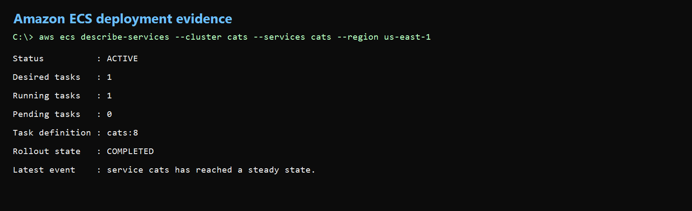
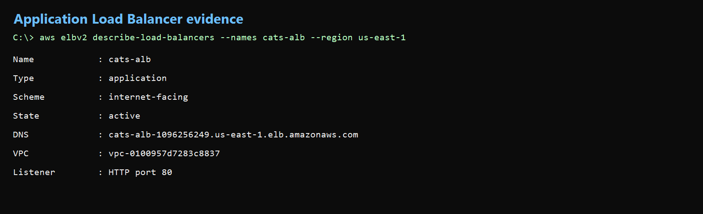
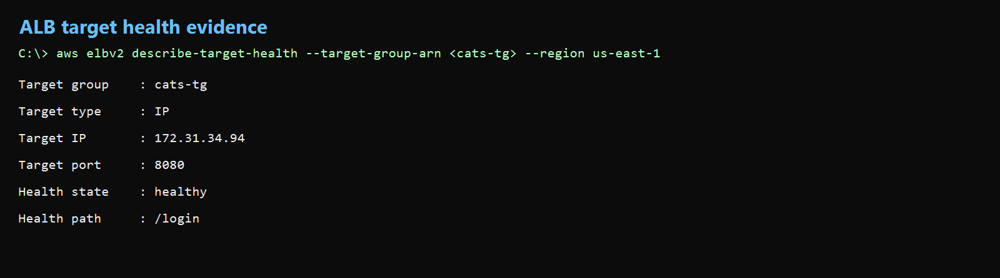
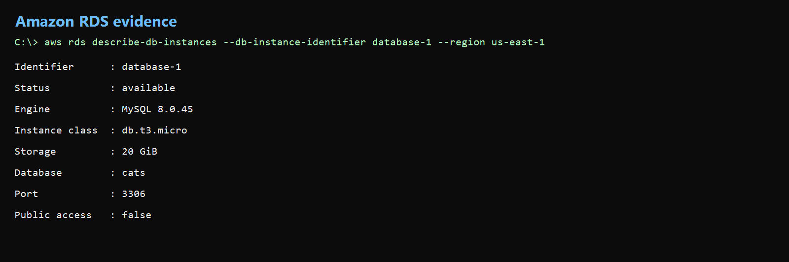
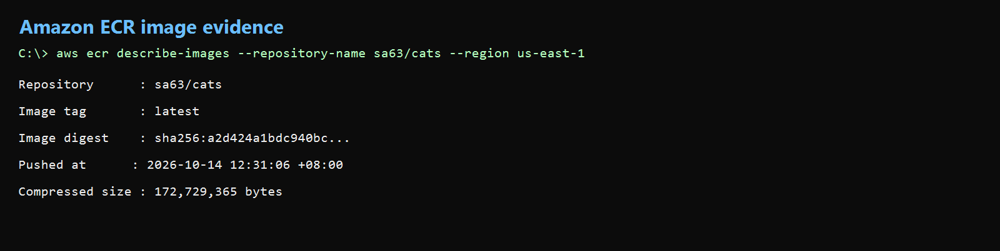
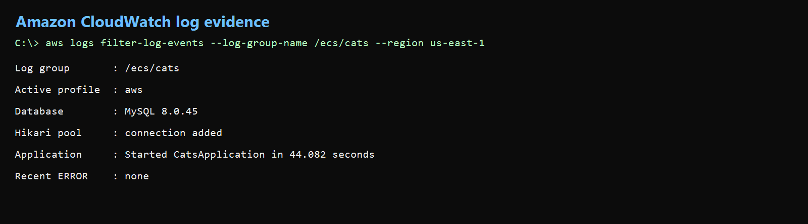

# CATS AWS Deployment Evidence

Team 8 · SA63 · 14 October 2026 · `us-east-1`

This page records the CATS application running on Amazon ECS with AWS
Fargate. It also records the Application Load Balancer, healthy target, RDS
database, ECR image and CloudWatch startup result. The screenshots below are
the same evidence captured in *CATS AWS Deployment Evidence.docx*.

## Application address

```text
http://cats-alb-1096256249.us-east-1.elb.amazonaws.com/login
```

The authenticated employee page is:

```text
http://cats-alb-1096256249.us-east-1.elb.amazonaws.com/applications
```

The ALB supplies one stable address for the website and application-generated
links. The Fargate task can be replaced without changing this address, provided
the ALB is retained.

AWS Academy resources are temporary. This URL is kept as a record of the
verified deployment. The lab may now be torn down, in which case the address
will no longer load.

## How CATS is hosted

1. Maven packages the Spring Boot application as
   `cats-0.0.1-SNAPSHOT.jar`.
2. Docker packages the JAR with a Java 21 runtime.
3. The image is tagged `sa63/cats:latest` and pushed to Amazon ECR.
4. ECS task definition `cats:8` runs the image using AWS Fargate.
5. ECS service `cats` maintains one running task.
6. The internet-facing ALB `cats-alb` receives HTTP traffic on port 80.
7. Target group `cats-tg` forwards the traffic to the ECS task on port 8080.
8. The Spring Boot application connects to the private RDS MySQL database on
   port 3306.
9. Application logs are written to CloudWatch log group `/ecs/cats`.
10. The AWS profile is selected at runtime and the ALB address is supplied as
    the application base URL.

## Network controls

- The ALB security group accepts HTTP port 80 from the internet.
- The ECS security group accepts port 8080 only from the ALB security group.
- The RDS security group accepts port 3306 only from the ECS security group.
- RDS is not publicly accessible.
- ECS, ALB and RDS use VPC `vpc-0100957d7283c8837`.
- The ALB and RDS subnet group use subnets in two Availability Zones.

## Deployment details

| Item | Value |
|---|---|
| AWS account | `590272943278` |
| AWS region | `us-east-1` |
| ECS cluster / service | `cats` / `cats` |
| Task definition | `cats:8` |
| Desired/running tasks | `1/1` |
| ECR repository and tag | `sa63/cats:latest` |
| Load balancer | `cats-alb` |
| Target group / state | `cats-tg` / `healthy` |
| RDS identifier | `database-1` |
| Database | MySQL 8.0.45, `db.t3.micro`, 2 GiB, `cats` |
| CloudWatch log group | `/ecs/cats` |

## Verified result

- The ALB login page returned HTTP 200.
- Administrator authentication opened the CATS administration page.
- Employee authentication opened the My Applications page.
- ECS reported one running task and a completed rollout.
- The ALB target was healthy.
- RDS reported `available`.
- CloudWatch recorded `Started CatsApplication`.
- No recent application errors were found during verification.

Successful authentication and application data display confirm the full path:

```text
Browser -> ALB -> ECS Fargate -> RDS MySQL
```

## Evidence screenshots

The live application screenshots and AWS console pictures come from the Word
document. The CLI result images confirm the same ECS, ALB, RDS, ECR and
CloudWatch state. No AWS access keys, database passwords, session tokens or
Gmail application passwords are included.

Email receipt screenshots are not included because no new external email test
was performed while collecting this evidence.

### Live CATS login through the ALB


**Figure 1.** The CATS login page is available through the public ALB hostname.

### Authenticated application result


**Figure 2.** The employee My Applications page loaded through ALB, ECS and RDS.

### ECS deployment result



**Figure 3.** ECS service `cats` is `ACTIVE`, one task is running, and the
rollout completed.

### Application Load Balancer result




**Figure 4.** The internet-facing Application Load Balancer is active and has a
public DNS name.

### ALB target health result



**Figure 5.** Target group `cats-tg` reports one healthy ECS target on port
8080.

### RDS database result




**Figure 6.** RDS MySQL database `database-1` is available.

### ECR image result




**Figure 7.** The latest CATS image is stored in ECR repository `sa63/cats`.

### CloudWatch startup result



**Figure 8.** The application started with the AWS profile and no recent errors
were found.

### Deployment architecture


**Figure 9.** Browser traffic passes through ALB to ECS, which connects to
private RDS and Gmail SMTP.
